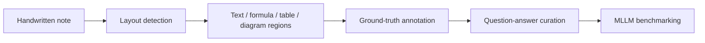
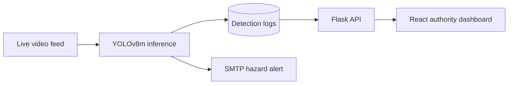
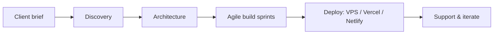

<div align="center">

<!-- ═══════════ EVERGREEN: self-hosted SVG, never needs editing ═══════════ -->
<a href="https://ranadebsaha.netlify.app">
  
</a>

<br/>

<a href="https://ranadebsaha.netlify.app"></a>
<a href="https://linkedin.com/in/ranadebsaha"></a>
<a href="mailto:ranadebsaha2002@gmail.com"></a>
<br/>
<a href="mailto:ranadebsaha2002@gmail.com?subject=DevSaha%20Tech%20Project%20Inquiry"></a>


<br/><br/>

**[⚡ 30-sec scan](#-30-second-scan) · [🚀 Featured](#-featured-works) · [📊 Impact](#-impact-ledger) · [🧰 Arsenal](#-tech-arsenal) · [🔍 Deep dives](#-deep-dives) · [🤝 Contact](#-initiate-transmission)**

</div>

<br/>

<!-- ═══════════════════════════════════════════════════════════════════════
     ✏️  UPDATE ZONE 1 — edit this block when you change jobs, get promoted,
         ship something new, or change what you're open to.
     ═══════════════════════════════════════════════════════════════════════ -->
<div align="center">

| 📍 NOW | 🧪 SHIPPING | 📡 OPEN TO |
|:---:|:---:|:---:|
| **Trainee Software Engineer**<br/>Aponiar Solution Pvt Ltd<br/>*(Aug 2026 → present)* | DevSaha Tech client builds<br/>NoTeS-Bank research<br/>Production web + mobile systems | SDE / AI-engineer roles<br/>Freelance via DevSaha Tech<br/>Research collaborations |

</div>

<details>
<summary><b>📜 Profile changelog</b> <sub>(newest first)</sub></summary>

<br/>

| Date | Update |
|---|---|
| **Aug 2026** | Joined **Aponiar Solution Pvt Ltd** as Trainee Software Engineer |
| **Jul 2026** | Completed **B.E. in Information Technology** (CGPA 8.99); wrapped up campus-lead & mentor term |
| **2026** | **GATE 2026 qualified** in Computer Science & IT |
| **Dec 2025** | Completed the **AI-Integrated Leadership Program** (Aspire Institute) |
| **Nov 2025** | Finished internship at **Infiuni Tech** (Django/React ERPs) |

</details>
<!-- ═══════════════════════ END UPDATE ZONE 1 ═══════════════════════════ -->

---

## ⚡ 30-Second Scan

| | |
|---|---|
| 🧑‍💻 **Engineer** | Trainee SWE at Aponiar · ex-Full Stack Intern at Infiuni Tech (Django/React ERPs for jewelry & rice industries) |
| 🏢 **Founder** | **DevSaha Tech** — MSME / Udyam-registered agency: Cholo Pujo · The Highway Café · GuideKart |
| 🔬 **Researcher** | NoTeS-Bank handwritten VQA dataset with **CVIT Lab (IIIT Hyderabad)** × **CVC (Spain)** · CB AI YOLOv8 detector (**95%**) |
| 🌱 **Leader** | GeeksforGeeks Campus Mantri · HackerRank lead · mentored **500+** developers · Aspire Leaders Program (Harvard Faculty) |
| 🎓 **Credentials** | B.E. IT, University of Burdwan (**8.99 CGPA**) · **GATE 2026 qualified** · Naukri Young Turks **97.13 percentile** |

---

## 🖥️ `boot.sh`

```bash
$ whoami
ranadeb-saha          # West Bengal, India (UTC+05:30)

$ cat /etc/identity.conf
ROLE_01="Software Engineer — web, mobile, REST APIs, PostgreSQL"
ROLE_02="Founder — DevSaha Tech, custom digital systems for real clients"
ROLE_03="Researcher — MLLMs, OCR, computer vision, dataset curation"
ROLE_04="Mentor — workshops, code reviews, coding contests"

$ echo $PRINCIPLE
"Build systems that survive real users, real data, and real deadlines."
```

---

## ⚙️ Runtime Profile

```javascript
// ranadeb.runtime.js — the system behind the engineer
const ranadeb = {
  identity: {
    name: "Ranadeb Saha",
    base: "West Bengal, India",
    degree: "B.E. Information Technology — University of Burdwan (CGPA 8.99)",
    diploma: "Diploma, CS & Technology — Central Calcutta Polytechnic (CGPA 8.6)",
    gate2026: "Qualified — Computer Science & IT",
  },

  <!-- // ✏️ UPDATE ZONE 2 — change when your role changes -->
  now: {
    role: "Trainee Software Engineer",
    company: "Aponiar Solution Pvt Ltd",
    since: "Aug 2026",
    focus: ["scalable web & mobile services", "performance optimization"],
  },

  venture: {
    entity: "DevSaha Tech (MSME / Udyam-registered)",
    shipped: ["Cholo Pujo", "The Highway Café & Restaurant", "GuideKart"],
  },

  research: {
    project: "NoTeS-Bank — handwritten VQA dataset for MLLMs",
    collaborators: ["CVIT Lab, IIIT Hyderabad", "CVC, Spain"],
    scale: "1,000+ curated scientific notes",
  },

  community: {
    roles: ["GeeksforGeeks Campus Mantri", "HackerRank lead", "Coding Junction core mentor"],
    reach: "500+ developers mentored · 5+ contests organised (+150% participation)",
  },

  open_to: ["SDE roles", "Freelance via DevSaha Tech", "Research collaborations"],
};

export default ranadeb;
```

---

## 🏗️ System Blueprint

```text
                        ┌───────────────────────────────┐
                        │         RANADEB  SAHA         │
                        └──────────────┬────────────────┘
        ┌──────────────────┬───────────┴───────┬───────────────────┐
        ▼                  ▼                   ▼                   ▼
 ┌──────────────┐  ┌──────────────┐   ┌───────────────┐   ┌───────────────┐
 │  ENGINEER    │  │   FOUNDER    │   │  RESEARCHER   │   │    MENTOR     │
 │ Django/React │  │ DevSaha Tech │   │ NoTeS-Bank    │   │ GFG·HackerRank│
 │ Node · DRF   │  │ Cholo Pujo   │   │ CB AI (YOLO)  │   │ Coding Junction│
 │ PostgreSQL   │  │ Highway Café │   │ OCR · MLLMs   │   │ Aspire Leaders│
 └──────┬───────┘  └──────┬───────┘   └───────┬───────┘   └───────┬───────┘
        └─────────────────┴─────────┬─────────┴───────────────────┘
                                    ▼
              scalable systems · measurable impact · people who grow
```

---

## 🚀 Featured Works

<table width="100%">
  <tr>
    <td width="50%" valign="top">
      <h3>🛒 HaatBazar — Hyperlocal Commerce + AI Image Search</h3>
      <p>
        
        
        
        
        
      </p>
      <p>A direct-to-consumer marketplace connecting local vendors to buyers without intermediaries.</p>
      <ul>
        <li><b>+20%</b> vendor profit margins through intermediary elimination</li>
        <li>AI image recognition in <b>under 2s</b> + live WebSocket order edits → <b>−30%</b> cancellations</li>
      </ul>
      <p>
        <a href="https://github.com/ranadebsaha?tab=repositories&q=haatbazar"></a>
        
      </p>
    </td>
    <td width="50%" valign="top">
      <h3>🚧 CB AI — Computer Vision + YOLOv8 Safety Dashboard</h3>
      <p>
        
        
        
        
        
      </p>
      <p>Real-time road debris and hazard detection with an authority-facing monitoring dashboard.</p>
      <ul>
        <li>Trained and deployed <b>YOLOv8m</b> at <b>95% accuracy</b> on live video feeds</li>
        <li>React + Flask dashboard and automated SMTP alerts → <b>−50%</b> incident response time</li>
      </ul>
      <p>
        <a href="https://github.com/ranadebsaha?tab=repositories&q=cb+ai"></a>
        
      </p>
    </td>
  </tr>
  <tr>
    <td width="50%" valign="top">
      <h3>🧠 NoTeS-Bank — Multimodal LLM / OCR Research</h3>
      <p>
        
        
        
        
        
      </p>
      <p>Research with <b>CVIT Lab (IIIT Hyderabad)</b> and <b>CVC (Spain)</b> on how multimodal models read handwritten science.</p>
      <ul>
        <li>Co-developed a handwritten <b>VQA dataset</b> for MLLM research</li>
        <li>Curated <b>1,000+</b> scientific notes with equations and tables; produced ground-truth annotations for text, formulas and diagrams</li>
      </ul>
      <p>
        <a href="https://github.com/ranadebsaha?tab=repositories&q=notes"></a>
        
      </p>
    </td>
    <td width="50%" valign="top">
      <h3>⚡ DevSaha Tech — Flagship Client Architecture</h3>
      <p>
        
        
        
        
        
      </p>
      <p>MSME / Udyam-registered agency building tailored digital systems for real clients.</p>
      <ul>
        <li><b>Cholo Pujo</b> — festive crowd &amp; route navigation with <b>Bengali voice assistance</b></li>
        <li><b>The Highway Café</b> — React Native APK + web POS + Node.js/Supabase backend · <b>GuideKart</b> — Next.js/TypeScript admin platform</li>
      </ul>
      <p>
        <a href="https://ranadebsaha.netlify.app"></a>
        
      </p>
    </td>
  </tr>
</table>

---

## 📊 Impact Ledger

<div align="center">

| Metric | Result | Where |
|:---|:---:|:---|
| Manual data entry |  | Infiuni Tech — ERP bulk import, validation, auto-reconciliation |
| API response time |  | Infiuni Tech — PostgreSQL index tuning, Node.js / DRF APIs |
| Vendor profit margins |  | HaatBazar — intermediary elimination |
| Order cancellations |  | HaatBazar — real-time WebSocket order edits |
| Detection accuracy |  | CB AI — YOLOv8m on live video |
| Incident response time |  | CB AI — authority dashboard + SMTP alerts |
| Support processing time |  | Cyber Bandhu — SLA tracking, admin dashboards |
| Student participation |  | 5+ university coding contests organised |
| Developers mentored |  | Web development & C/C++ mentoring |

</div>

---

## 🧰 Tech Arsenal

<div align="center">

| Layer | Technologies | Visual |
|:---|:---|:---:|
| **Languages** | `Java` `Python` `C` `JavaScript (ES6+)` `TypeScript` `SQL` |  |
| **Frontend** | `React.js` `Next.js` `React Native` `Tailwind CSS` `Bootstrap` `HTML5/CSS3` |  |
| **Backend** | `Node.js` `Express.js` `Django` `Django REST Framework` `Flask` `REST APIs` `WebSockets` |  |
| **Databases** | `PostgreSQL` `MongoDB` `MySQL` `Oracle` `Supabase` `SQLite` |  |
| **AI / CV** | `YOLOv8` `OpenCV` `OCR` `Multimodal Learning` `Data Annotation` |  |
| **Cloud & DevOps** | `AWS (EC2, S3)` `Docker` `Linux` `Nginx` `Git` `GitHub` `Vercel` `Netlify` `Hostinger VPS` `cPanel` |  |

</div>

---

## 🔍 Deep Dives

> Expand a module for architecture, decisions and outcomes.

<details>
<summary><b>🏢 [01] Enterprise Engineering — Aponiar Solution & Infiuni Tech</b></summary>

<br/>

**Trainee Software Engineer @ Aponiar Solution Pvt Ltd** *(Aug 2026 → present · New Town, Kolkata)*
- Developing scalable web and mobile software solutions and researching ways to optimize application performance.

**Full Stack Developer Intern @ Infiuni Tech** *(May 2025 – Nov 2025 · Hybrid)*
- Engineered ERP solutions for the **jewelry** and **rice** industries with **Django** and **React**.
- Cut manual data entry by **40%** through bulk import, form validation and automated reconciliation.
- Architected REST APIs (**Node.js / DRF**) and tuned **PostgreSQL** queries and indexes for a **25%** faster API response time.

```bash
# the shape of the optimisation loop
EXPLAIN ANALYZE SELECT ...;        # find the slow path first
CREATE INDEX CONCURRENTLY ...;     # index the hot filters, not everything
```

</details>

<details>
<summary><b>🔬 [02] Research — NoTeS-Bank (IIIT Hyderabad × CVC Spain)</b></summary>

<br/>

**Jan 2025 – Jul 2026 · Python · OCR · ColPali · Florence-2**

- Co-developed a **handwritten Visual Question Answering** dataset with **CVIT Lab (IIIT Hyderabad)** and **CVC (Spain)** for advanced MLLM research.
- Curated **1,000+ scientific notes** with equations and tables to improve OCR layout-detection accuracy.
- Generated ground-truth annotations for text, formulas and diagrams to support training of Multimodal LLMs.



</details>

<details>
<summary><b>🚧 [03] Computer Vision — CB AI (Hack4Bengal 2025)</b></summary>

<br/>

**May 2025 – Jun 2025 · Python · YOLOv8m · Flask · React · SMTP**



- Trained and deployed a real-time debris-detection model at **95% accuracy** on live video.
- Built the monitoring dashboard authorities use to review detections, cutting incident response time by **50%**.
- Automated SMTP email notifications so hazards escalate in real time.

</details>

<details>
<summary><b>🛒 [04] Product — HaatBazar (StatusCode 2025)</b></summary>

<br/>

**Jul 2025 – Aug 2025 · Django REST · React.js · PostgreSQL · MongoDB GeoJSON · WebSockets · AI/ML**

- Hyperlocal direct-to-consumer marketplace; removing middlemen lifted vendor margins by **20%**.
- AI image recognition in **under 2 seconds** for product discovery.
- WebSocket-powered live order edits and sync reduced cancellations by **30%**.

```javascript
// conceptual: real-time order sync
socket.on("order:update", (order) => {
  store.dispatch(orderUpdated(order)); // buyer and vendor see edits instantly
});
```

</details>

<details>
<summary><b>🚀 [05] Founder — DevSaha Tech</b></summary>

<br/>

MSME / Udyam-registered software engineering agency delivering custom digital architectures, enterprise web solutions and smart civic utilities.

| Product | What it is | Stack |
|---|---|---|
| **Cholo Pujo** | Smart crowd / route navigation platform for festive seasons in West Bengal, with Bengali voice assistance and route optimization | Web platform, voice interface |
| **The Highway Café & Restaurant** | Cross-platform ordering suite | React Native APK · Web POS · Node.js · Supabase |
| **GuideKart** | Administrative dashboard and web platform | Next.js · TypeScript |
| **Cyber Bandhu** | Digital assistance portal with role-based access and SLA tracking; **−35%** support processing time | MERN · JWT |



</details>

<details>
<summary><b>🌱 [06] Community — GeeksforGeeks · HackerRank · Coding Junction</b></summary>

<br/>

**May 2024 – Jul 2026 · Burdwan, West Bengal**

- Mentored **500+ members** in Web Development and C/C++; ran code reviews and workshops that improved code quality and project completion rates.
- Led university coding initiatives and organised **5+ technical contests**, raising student participation by **150%** through targeted outreach and streamlined registration.
- Alumnus of the **Aspire Leaders Program** (Aspire Institute, Harvard Faculty) and the **AI-Integrated Leadership Program**.

</details>

<details>
<summary><b>🎓 [07] Education, Honors & Hackathons</b></summary>

<br/>

| Category | Details |
|---|---|
| 🎓 **B.E. Information Technology** | University Institute of Technology, University of Burdwan · **CGPA 8.99** · Aug 2023 – Jul 2026 |
| 🎓 **Diploma, CS & Technology** | Central Calcutta Polytechnic · **CGPA 8.6** · Aug 2021 – Jun 2023 |
| 🧠 **GATE 2026** | Qualified — Computer Science & IT |
| 📈 **Naukri Campus Young Turks** | Rank **14,670** · **97.13 percentile** |
| 🏁 **Hackathons** | StatusCode 2025 (HaatBazar) · Hack4Bengal 2025 (CB AI) · Diversion 2025 |
| 💰 **Scholarships** | Swami Vivekananda Merit-cum-Means · National Means-cum-Merit (NMMS) |
| 📜 **Certifications** | Aspire Leaders Program (Mar 2025) · AI-Integrated Leadership Program (Dec 2025) · Cyber Security Awareness, NIELIT (Jan 2024) · Git & GitHub Masterclass, Physics Wallah (Jan 2025) |

</details>

---

## 🤝 Initiate Transmission

> [!TIP]
> **Open to high-impact engineering roles, custom builds through DevSaha Tech, and AI research collaborations.**
> - **SDE / AI engineer roles:** resilient backends, full-stack products, applied ML pipelines.
> - **DevSaha Tech clients:** MVPs, ERPs, mobile apps, AI-integrated platforms.
> - **Research:** dataset curation, OCR / vision-language benchmarking, academic–industry partnerships.

<div align="center">

| 💼 Hiring? | 🏢 Need a product built? | 🔬 Research collab? |
|:---:|:---:|:---:|
| [](mailto:ranadebsaha2002@gmail.com?subject=Opportunity%20for%20Ranadeb%20Saha) | [](mailto:ranadebsaha2002@gmail.com?subject=DevSaha%20Tech%20Project%20Inquiry) | [](mailto:ranadebsaha2002@gmail.com?subject=Research%20Collaboration) |

```bash
$ ./contact --to ranadebsaha2002@gmail.com --channel email,linkedin,whatsapp
> typical response: fast
```

<a href="https://linkedin.com/in/ranadebsaha"></a>
<a href="https://wa.me/916295111477"></a>
<a href="https://ranadebsaha.netlify.app"></a>

<br/><br/>


<br/><br/>

<!-- EVERGREEN footer -->


</div>
